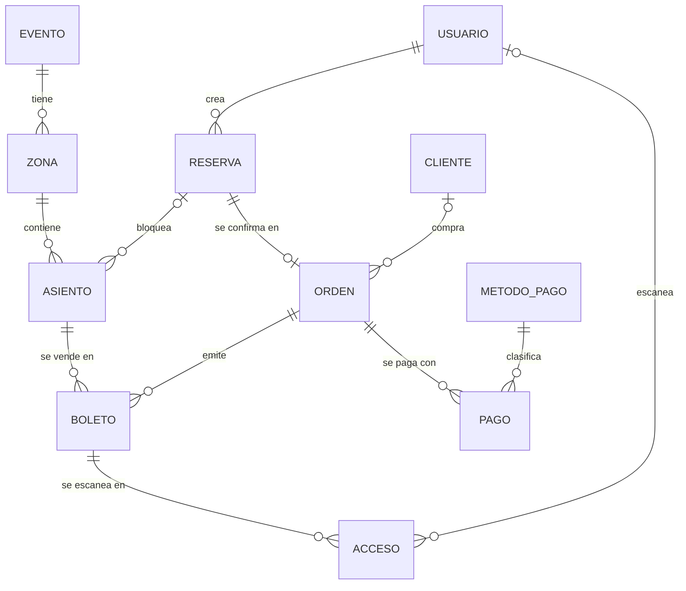

# Modelo de dominio

## Diagrama

## Reglas de negocio

1. El precio de una zona no puede ser negativo y su capacidad debe ser mayor que 0.
2. Un asiento solo se reserva si esta Disponible o si su reserva anterior ya venció.
3. Una reserva vence a los N minutos y libera sus asientos.
4. Solo se confirma una reserva Activa y no vencida.
5. El total de la orden es la suma de los precios de sus boletos al momento de la venta.
6. Un asiento vendido nunca vuelve a reservarse.

## Decisiones de diseño

- El precio vive en la zona, no en cada asiento, para modificarlo en un solo lugar.
- El estado se guarda en el asiento, lo que permite controlar la concurrencia con un token de versión.
- Cada reserva da lugar a una sola orden.
- El boleto reemplaza a una OredenItem: guarda asiento, precio pagado, codigo QR y estado.
- no hay entidad PuntoAcces: Acceso tiene un campo `Puerta`.

## Fuera de alcance (mejoras futuras)

- Membresías y descuentos para clientes.
- Productos que no sean asientos(estacionamiento, mercancía), que necesitarían volver a las lineas de orden.

## Entidades

| Entidad | Identificador | Datos clave | Relaciones |
|---|---|---|---|
| Evento | Id | Nombre, FechaHora, Estado | Tiene Zonas |
| Zona | Id | Nombre, Precio, Capacidad | De un Evento; tiene Asientos |
| Asiento | Id | Fila, Número, Estado, ReservadoHasta, versión | De una Zona; puede estar en una Reserva; se vende en Boletos |
| Usuario | Id | Nombre, Email, PasswordHash, Rol | Crea Reservas; escanea Accesos |
| Cliente | Id | Nombre, Email (opcional), Tipo | Compra Órdenes (opcional) |
| Reserva | Id | CreadaEn, ExpiraEn, Estado | De un Usuario; bloquea Asientos; se confirma en una Orden |
| Orden | Id | Total, FechaPago, Estado | De una Reserva; emite Boletos; se paga con Pagos |
| Boleto | Id | Código QR único, PrecioPagado, Estado | De una Orden y de un Asiento; se escanea en Accesos |
| MetodoPago | Id | Nombre | Clasifica Pagos |
| Pago | Id | Monto, Referencia, FechaPago | De una Orden y de un MetodoPago |
| Acceso | Id | EscaneadoEn, Puerta, Resultado | De un Boleto; escaneado por un Usuario (opcional) |

## Qué pasa si dos cajeros reservan el mismo asiento

Cuando dos cajeros intentan reservar el mismo asiento al mismo tiempo, solo el primero en guardar tiene éxito y se queda con él. Al segundo se le avisa del conflicto, porque encuentra que la versión del asiento ya cambió, y su reserva no se realiza. Así se garantiza que un asiento nunca se venda dos veces.